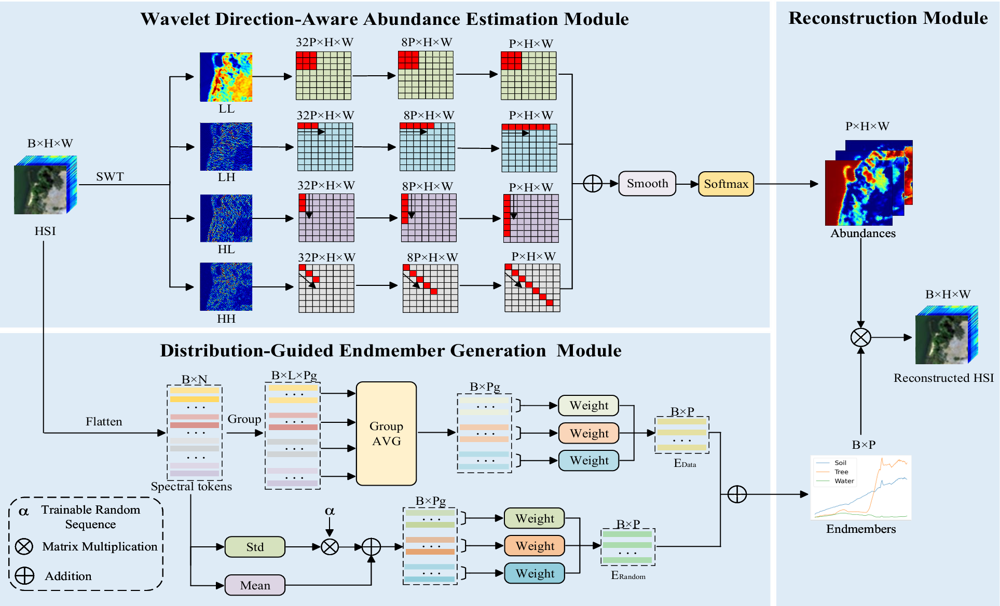

# WDA-NET: WAVELET DIRECTION-AWARE NETWORK FOR HYPERSPECTRAL UNMIXING

<strong>:fire:New:bangbang:</strong></font></sup> Code is now available here.
___________

The repository contains the PyTorch implementations for WDA-Net: WDA-NET: WAVELET DIRECTION-AWARE NETWORK FOR HYPERSPECTRAL UNMIXING


## Environment

This project is recommended to run with **Python 3.10.20**.

## Installation

Please install the required dependencies before running the code:

```bash
pip install -r requirements.txt
```

## Introduction



If you use the code in your research, we would appreciate a citation to the original paper:


